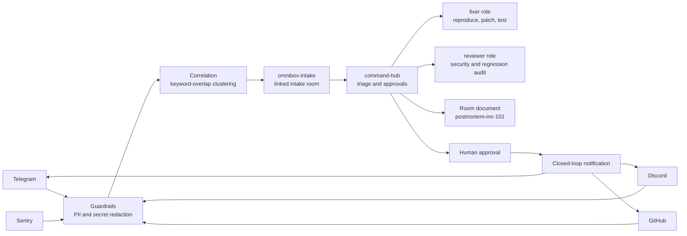

# SwitchMesh

**Flip the Switch Hackathon project** — a cross-platform incident mesh that turns noisy production signals into one safe, traceable engineering response.

## The Flash-Sale Crash

During a Friday flash sale, customers entered the `FREESHIP` promo code and received a checkout `500`. The same failure arrived through four different channels:

- **Telegram** — a customer report from the support community
- **Discord** — an escalation from the engineering community
- **Sentry** — the production exception and stack trace
- **GitHub** — an issue with reproduction details

Without correlation, responders investigate four alerts, repeat work, and risk forwarding personal data while the incident is still unfolding. SwitchMesh redacts PII at the webhook boundary, correlates the signals into one incident (`INC-101`), and keeps the response auditable from first report to human-approved release.

## Architecture



## Why Switch Is Central

SwitchMesh is built around Switch primitives, not just a webhook collector:

- **Linked rooms** keep intake (`omnibox-intake`) and engineering command (`command-hub`) connected without losing context.
- **Room-scoped roles** give the exclusive `fixer` and shared `reviewer` clear responsibilities and durable handoffs.
- **Room documents** preserve the redacted incident narrative, patch summary, and test evidence for every participant.
- **Human approval** is an explicit safety boundary before the resolution is announced externally.
- **Agent protocol support** handles registration, room discovery, messages, and live connection cursors.

## What the Demo Shows

The local command hub at `http://127.0.0.1:8000/` provides a dark-mode operations dashboard with:

- correlated Telegram, Discord, Sentry, and GitHub incident cards;
- aggregate PII values redacted at the guardrail boundary;
- buttons to simulate webhooks, spawn a war room, and approve a fix;
- live incident status from the same API used by the simulator.

## Local Setup in Under 5 Minutes

### 1. Create the environment

PowerShell:

```powershell
python -m venv .venv
.\.venv\Scripts\Activate.ps1
python -m pip install fastapi uvicorn httpx pytest
```

### 2. Start the command hub

```powershell
uvicorn switchmesh.hub.server:app --reload
```

Open [http://127.0.0.1:8000/](http://127.0.0.1:8000/).

### 3. Fire the four-source incident burst

In a second terminal:

```powershell
python switchmesh/scripts/simulate_chaos.py
```

The simulator sends Telegram, Discord, Sentry, and GitHub signals concurrently. They should converge on `INC-101`; the dashboard then lets you open a war room and approve the resolution.

### 4. Run the tests

```powershell
pytest -q
```

The suite covers webhook redaction and correlation, command handling, the FREESHIP checkout regression, room discovery, and Switch protocol requests.

## Wispr Flow Voice Workflow

Wispr Flow makes the demo feel like an incident commander workflow:

1. Start the command hub and keep the dashboard open.
2. Dictate: **“Checkout FREESHIP is returning 500; correlate this as a flash-sale incident.”**
3. Send the dictated report to the intake webhook. Guardrails redact secrets and personal data before correlation.
4. Dictate: **“Open the INC-101 war room and assign the fixer role.”**
5. After the patch and reviewer summary are posted, dictate: **“Approve INC-101 and notify Telegram, Discord, and GitHub reporters.”**

Voice captures intent; Switch rooms, roles, documents, and approvals preserve the durable audit trail.

## Project Layout

```text
switchmesh/
├── demo_cart_service/       # Checkout demo and FREESHIP regression test
├── hub/
│   ├── dedup.py              # Incident correlation
│   ├── guardrails.py         # PII and secret redaction
│   ├── server.py             # Dashboard, webhooks, and commands
│   └── switch_client.py      # Switch Agent Protocol client
├── router.py                 # Environment config and room discovery
└── scripts/simulate_chaos.py # Four-source incident simulator
tests/test_switchmesh.py     # Hub and protocol tests
```

## License

Add the project license here after the hackathon team decides on one.
